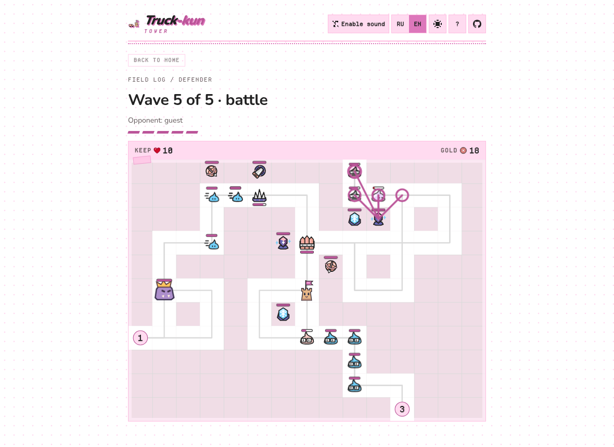

<p align="center"></p>

# Truck-kun Tower

A tower defence siege for two players in the browser. One player guards a keep at the end of a random slime maze, the other buys slimes and picks the gates they come from

[](docker-compose.yml) [](ASSETS.md)


## What it is

Two people open one link and take opposite sides of the same maze. The defender spends gold on towers and fences. The attacker spends gold on slimes and chooses an entrance for every group

The server generates the maze and resolves each wave. The browser replays the result, so the two screens stay in step

## How a match plays

- The maze is new in every room and shared by both players. Each entrance reaches the keep, and most of them fork on the way
- The defender may build on a wall next to the road, or raise a fence on the road itself. A fence stops a slime until it breaks the fence
- The attacker queues groups per entrance. Slimes from one gate leave one at a time, and different gates work at once
- A plain slime picks a branch at a fork. A slime with glasses always takes the shortest way and costs twice as much
- Gold arrives for both players after each wave, and every wave pays more than the one before
- The keep falls at zero hearts. A keep that stands after the last wave decides the match on the hearts left

| Defence | Attack |
| --- | --- |
|  |  |

## Run it with Docker

```sh
docker compose up --build
```

The game then answers on <http://localhost:5184>, and the database lives in the `tower-data` volume, so a restart keeps the played matches

To keep the database in a folder on the host instead, mount it and give the container user access

```sh
mkdir -p data && sudo chown 1654:1654 data
docker compose down
docker run --rm -p 5184:8080 -v "$PWD/data:/data" truck-kun-tower
```

Without compose

```sh
docker build -t truck-kun-tower .
docker run --rm -p 5184:8080 -v "$PWD/data:/data" truck-kun-tower
```

Two people play on one address: the first opens it, presses "Создать дуэль" and sends the invite link to the second. The first tab defends, the second attacks, and both need the same host

## Public HTTPS

The live copy sits on a VPS whose port 443 belongs to a VPN, so the game is served on a non-standard port by choice rather than by accident

- An `A` record `tower` points at the VPS and Cloudflare proxies it, so the visitor sees `https://tower.rokokol.art` through Cloudflare's certificate
- The game itself answers on `8443` with a Let's Encrypt certificate for `tower.rokokol.art`; certbot renews it through the `/.well-known/acme-challenge/` location in `deploy/vps/nginx.conf`
- `nginx` on port `80` keeps the plain-HTTP path for a proxied zone, and both listeners hand the request to `127.0.0.1:5184`

Nothing in the game depends on a messenger: a player is a browser tab with a ticket in `localStorage`, and the invite is a plain link

## Run it for development

With the .NET SDK alone, from this directory

```sh
dotnet run --urls http://localhost:5184
```

## Data

Matches are kept in SQLite through Entity Framework Core. A running game lives in memory, and a finished match goes to the database with its waves

To look inside the volume

```sh
docker compose exec tower ls -l /data
```

Two endpoints read the database with LINQ over the tables

| Endpoint | Answer |
| --- | --- |
| `GET /stats` | Matches played, wins per side, average waves and hearts left, and damage per wave number |
| `GET /matches?take=10` | The most recent finished matches |

```sh
curl -s localhost:5184/stats
```

## Checks

A running server answers both scripts

```sh
node check.mjs
node balance.mjs
```

- `check.mjs` holds the rules to their promises: a shared maze with a route from every gate, roles that cannot spend each other's gold, placement that refuses the road, a private attack queue, a fence that blocks until it breaks, and gold that rises
- `balance.mjs` plays scripted strategies against each other and prints the win count per pairing
