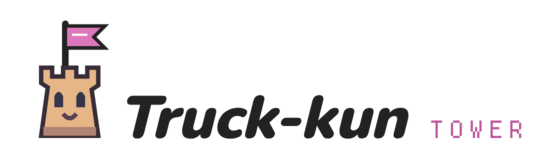
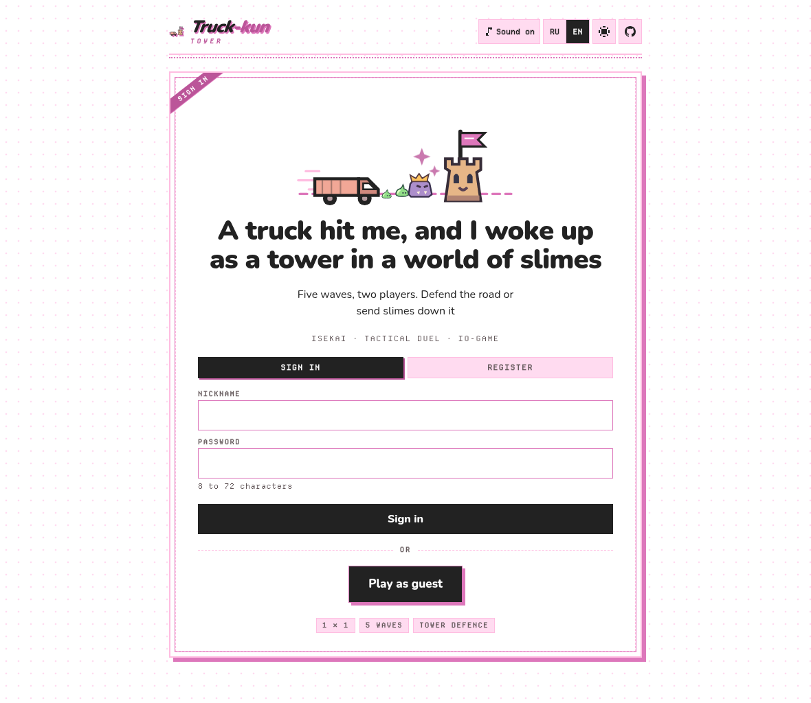
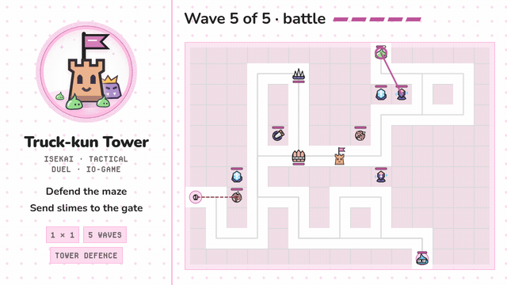

<p align="center"></p>

# Truck-kun Tower

An io-game of tower defence for two players in the browser. One player guards a keep at the end of a random slime maze, the other buys slimes and picks the gates they come from

[](docker-compose.yml) [](CHANGELOG.md) [](ASSETS.md)





## What it is

Two people take opposite sides of the same maze. The defender spends gold on towers and fences. The attacker spends gold on slimes and chooses an entrance for every group

The server generates the maze and resolves each wave. The browser replays the result, so the two screens stay in step

## Accounts, friends and invitations

- A player registers with a nickname and a password. The session is a JWT that lives in `localStorage` for a week
- Friends are added by nickname and confirmed by the other side; the list shows who is online right now
- A friend can be invited into a duel from the list. The invitation arrives live and stays in the database until it is answered
- A chair belongs to an account, but a guest with the invite link still plays without registering: the server hands that browser a random seat token
- Before the first wave either player may ask to switch sides; the other player agrees or refuses, and nothing is built yet
- One account holds one active duel at a time. Random matchmaking seats two players who are both looking, and a duel seen through a link works the same way
- The lobby shows who is online and keeps a history of past duels and matches, five rows at a time

## How a match plays

- The maze is new in every room and shared by both players. Each entrance reaches the keep, and most of them fork on the way
- The defender may build on a wall next to the road, or raise a fence on the road itself. A fence stops a slime until it breaks the fence
- The attacker queues groups per entrance. Slimes from one gate leave one at a time, and different gates work at once
- A plain slime picks a branch at a fork. A slime with glasses always takes the shortest way, and its gold price is higher than a plain slime's
- Each wave starts with a larger budget, but unused gold does not carry over. Only structures bought in the current wave give a refund
- The keep falls at zero hearts. A keep that stands after the last wave decides the match on the hearts left
- A finished match keeps the battle itself, so anyone with the link can replay it wave by wave without an account
- The guide screen reads its prices, hearts and damage from the same rules the fight uses

| Defence                                         | Attack                                |
| ----------------------------------------------- | ------------------------------------- |
|  |  |

## Run it with Docker

```sh
cp .env.example .env
# fill POSTGRES_PASSWORD and JWT_KEY (openssl rand -base64 48) in .env
docker build --network=host -t truck-kun-tower .
docker compose up -d --no-build
```

The image is built by hand because Compose 5 refuses the `network: host` its build section asks for, and NuGet restore inside the bridge fails on a host whose DNS goes through a VPN. The game then answers on <http://localhost:5184>. PostgreSQL keeps its data in the `tower-db` volume, so a restart keeps accounts, friends and the played matches

Without compose

```sh
docker build -t truck-kun-tower .
docker run --rm -p 5184:8080 --network host \
  -e ConnectionStrings__Default="Host=127.0.0.1;Port=5432;Database=tower;Username=tower;Password=..." \
  -e Jwt__Key="..." truck-kun-tower
```

## The API

The client talks to one REST service. Every answer is a DTO, errors are `ProblemDetails` with a Russian `detail`

| Group       | Endpoints                                                                                                                                                                                                                                                                          |
| ----------- | ---------------------------------------------------------------------------------------------------------------------------------------------------------------------------------------------------------------------------------------------------------------------------------- |
| Accounts    | `POST /api/auth/register`, `POST /api/auth/login`, `GET /api/auth/me`, `GET /api/users/{id}`, `PUT /api/users/me`, `DELETE /api/users/me`                                                                                                                                          |
| Friends     | `GET /api/friends`, `GET /api/friends/requests`, `POST /api/friends/requests`, `POST /api/friends/requests/{id}/accept`, `DELETE /api/friends/requests/{id}`, `DELETE /api/friends/{userId}`                                                                                       |
| Invitations | `GET /api/invites`, `POST /api/invites`, `POST /api/invites/{id}/accept`, `DELETE /api/invites/{id}`                                                                                                                                                                               |
| Duels       | `POST /api/duels`, `GET /api/duels?take=&skip=`, `GET /api/duels/{id}`, `POST /api/duels/random/join`, `POST /api/duels/{id}/join`, `POST /api/duels/{id}/swap`, `POST /api/duels/{id}/swap/accept`, `POST /api/duels/{id}/swap/decline`, `GET /api/duels/{id}/state`, `POST /api/duels/{id}/moves`, `DELETE /api/duels/{id}` |
| History     | `GET /api/matches`, `GET /api/matches/mine?take=&skip=`, `GET /api/matches/{id}`, `GET /api/matches/{id}/replay/{wave?}`, `PATCH /api/matches/{id}`, `DELETE /api/matches/{id}`, `GET /api/stats`, `GET /api/leaderboard`                                                                                                              |
| Players     | `GET /api/users/online`, `GET /api/rules`                                                                                                                                                                                                                                                                                    |

The live channel is SignalR at `/bell`: a room change, a friend request, an invitation, a side question and presence. A guest joins a room with the seat token, an account with its JWT

## Data

Five entities carry the durable side of the game

| Entity       | What it holds                                         |
| ------------ | ----------------------------------------------------- |
| `User`       | Nickname, PBKDF2 hash, registration date              |
| `Friendship` | Two players and the state of their request            |
| `DuelInvite` | An invitation to a room, with its answer              |
| `Room`       | A duel lobby: who sits on which side and how it ended |
| `Match`      | A finished match, with one `Wave` row per wave        |

A live board (maze, towers, timers) stays in memory; a room row says who was in it, so a restart marks it abandoned instead of pretending it is playable

```sh
curl -s localhost:5184/api/stats
curl -s "localhost:5184/api/matches?take=10"
curl -s "localhost:5184/api/leaderboard?take=5"
```

## Public HTTPS

The live game uses HTTPS both from the browser to Cloudflare and from Cloudflare to the VPS. See the [nginx site configuration](deploy/vps/nginx.conf)

## Run it for development

With the .NET SDK alone, from this directory, with the database up

```sh
docker compose up -d db
dotnet run --urls http://localhost:5184
```

## Checks

A running server answers both scripts

```sh
node check.mjs
node balance.mjs
```

- `check.mjs` walks the whole API: registration, friends, invitations, sides, the rules of the game, the history, the leaderboard
- `balance.mjs` plays scripted strategies against each other and prints the win count per pairing
- The unit tests mock the repositories and need no database

```sh
docker run --rm --network=host -v "$PWD:/src" -v nuget-cache:/root/.nuget/packages -w /src \
  mcr.microsoft.com/dotnet/sdk:8.0 dotnet test tests/TruckKun.Tower.Tests -p:ArtifactsPath=/tmp/art
```
