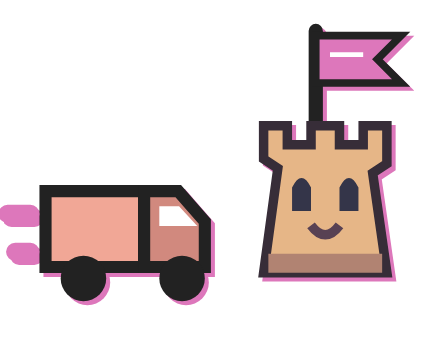
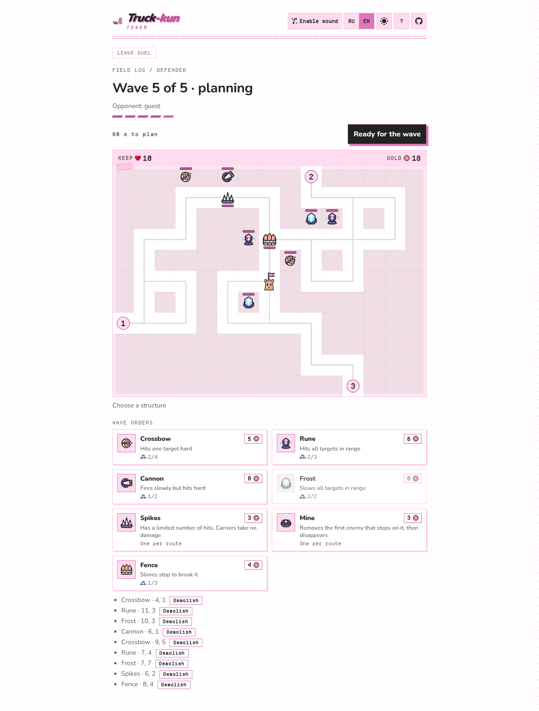

<p align="center"></p>

# Truck-kun Tower

A tower defence siege for two players in the browser. One player guards a keep at the end of a random slime maze, the other buys slimes and picks the gates they come from

[](docker-compose.yml) [](ASSETS.md)


## What it is

Two people open one link and take opposite sides of the same maze. The defender spends gold on towers and fences. The attacker spends gold on slimes and chooses an entrance for every group

The pair can also meet inside Telegram: the game runs as a Mini App, keeps the seat in CloudStorage and sends the opponent a `t.me` link. The browser flow stays, so nothing depends on Telegram being installed

The server generates the maze and resolves each wave. The browser replays the result, so the two screens stay in step

## How a match plays

- The maze is new in every room and shared by both players. Each entrance reaches the keep, and most of them fork on the way
- The defender may build on a wall next to the road, or raise a fence on the road itself. A fence stops a slime until it breaks the fence
- The attacker queues groups per entrance. Slimes from one gate leave one at a time, and different gates work at once
- A plain slime picks a branch at a fork. A slime with glasses always takes the shortest way and costs twice as much
- Gold arrives for both players after each wave, and every wave pays more than the one before
- The keep falls at zero hearts. A keep that stands after the last wave decides the match on the hearts left

| Defence | Attack |
| --- | --- |
|  |  |

## Run it with Docker

```sh
docker compose up --build
```

The game then answers on <http://localhost:5184>, and the database lives in the `tower-data` volume, so a restart keeps the played matches

To keep the database in a folder on the host instead, mount it and give the container user access

```sh
mkdir -p data && sudo chown 1654:1654 data
docker compose down
docker run --rm -p 5184:8080 -v "$PWD/data:/data" truck-kun-tower
```

Without compose

```sh
docker build -t truck-kun-tower .
docker run --rm -p 5184:8080 -v "$PWD/data:/data" truck-kun-tower
```

Two people play on one address: the first opens it, presses "Создать дуэль" and sends the invite link to the second. The first tab defends, the second attacks, and both need the same host

## As a Telegram Mini App

Inside Telegram the game fits one WebView. The page loads `telegram-web-app.js`, expands to the screen, respects the phone's safe area and keeps a closing confirmation while a duel is live. The room key goes to `Telegram.WebApp.CloudStorage` with `localStorage` as a mirror, so closing the app or opening it on another device returns the player to the same seat.

The invite panel then shows `https://t.me/truck_kun_tower_bot/truckkuntower?startapp=<room>` instead of the browser address, and a "Отправить в Telegram" button opens the chat picker. The second player taps the link and joins the attacker's seat. Outside Telegram the same panel keeps the browser link.

### The bot

[@truck_kun_tower_bot](https://t.me/truck_kun_tower_bot) is served by the game itself. On startup it reads `Telegram:BotToken`, calls `getMe`, removes a webhook if one is set — long polling and a webhook cannot share a bot — puts a «Играть» web-app menu button on the chat and answers `/start` with a launch button. Without a token the service logs why it is off and leaves the web game untouched.

| Setting | Meaning |
| --- | --- |
| `Telegram__BotToken` | BotFather token; the only secret |
| `Telegram__PublicUrl` | Public HTTPS address, `https://tower.rokokol.art` |
| `Telegram__AppLink` | Deep-link base: `https://t.me/<bot>` for the Main Mini App or `https://t.me/<bot>/<app>` for a named app. Empty means `https://t.me/<bot>` from `getMe` |
| `Telegram__ApiAddress` | Optional: the address of `api.telegram.org` to connect to, for a network that filters the name lookup. The certificate is still checked against the name |

### Public HTTPS

Telegram opens only a valid HTTPS address. The live deployment sits on a VPS whose port 443 belongs to a VPN, so Cloudflare stands in front: the visitor's TLS ends at Cloudflare, and Cloudflare reaches the game over plain HTTP on port 80, where nginx passes it to `127.0.0.1:5184`.

1. An `A` record `tower` points at the VPS, **Proxied** (orange cloud).
2. The zone's SSL/TLS mode is **Flexible**. `Full` would send Cloudflare to port 443, which the VPN owns, and the handshake would meet the wrong certificate.
3. On the VPS, `deploy/vps/docker-compose.yml` runs the game and `deploy/vps/nginx.conf` is the vhost.

The same vhost keeps an `8443` TLS listener with a Let's Encrypt certificate, which certbot obtains through the `/.well-known/acme-challenge/` location and a cron entry renews. Cloudflare passes that path through, so renewal works while the record is proxied.

Flexible leaves the Cloudflare-to-server hop unencrypted. Nothing secret travels there — the bot token stays on the server — but a Cloudflare Tunnel would encrypt that hop as well, need no open ports, and remove the dependence on the origin port.

### A network that filters Telegram

Some providers answer only for part of the Telegram address pool and drop the rest. `Telegram__ApiAddress` pins the one that answers: the bot connects to it, keeps `api.telegram.org` in the TLS handshake, and falls back to the ordinary lookup after a few failed attempts. Long polling rides over the occasional dropped connection, so the bot stays up, but without the pin it would knock on a dead address.

### One-time setup in BotFather

The bot needs the address of the Mini App, and it must be the public one:

- **Named app** (this repository's `.env` uses one): `/newapp`, pick the bot, set the URL to `https://tower.rokokol.art/` and put the chosen short name into `TELEGRAM_APP_LINK`, for example `https://t.me/truck_kun_tower_bot/truckkuntower`.
- **Main Mini App**: in `/mybots` → the bot → Bot Settings → Main Mini App, enable it with the same URL. Then `TELEGRAM_APP_LINK` can stay empty and links look like `https://t.me/truck_kun_tower_bot?startapp=<room>`.

The menu button is set by the bot, so `/setmenubutton` is not needed. If another service runs this bot, stop it first: polling cannot coexist with a webhook, and the game removes the webhook on startup.

## Run it for development

With the .NET SDK alone, from this directory

```sh
dotnet run --urls http://localhost:5184
```

## Data

Matches are kept in SQLite through Entity Framework Core. A running game lives in memory, and a finished match goes to the database with its waves

To look inside the volume

```sh
docker compose exec tower ls -l /data
```

Two endpoints read the database with LINQ over the tables

| Endpoint | Answer |
| --- | --- |
| `GET /stats` | Matches played, wins per side, average waves and hearts left, and damage per wave number |
| `GET /matches?take=10` | The most recent finished matches |
| `GET /config` | Telegram deep-link base and bot name; `telegram: null` when the bot is off |

```sh
curl -s localhost:5184/stats
```

## Checks

A running server answers both scripts

```sh
node check.mjs
node balance.mjs
```

- `check.mjs` holds the rules to their promises: a shared maze with a route from every gate, roles that cannot spend each other's gold, placement that refuses the road, a private attack queue, a fence that blocks until it breaks, and gold that rises
- `balance.mjs` plays scripted strategies against each other and prints the win count per pairing
